<div align="center">

<!-- HERO BANNER -->


<br/>

<!-- QUICK CONNECT ACTIONS -->
<p align="center">
  <a href="https://www.linkedin.com/in/mohanadas-thujeeban-63769625b" target="_blank">
    
  </a>
  &nbsp;
  <a href="mailto:thujee44@gmail.com">
    
  </a>
  &nbsp;
  <a href="https://github.com/MohanathasThujeeban">
    
  </a>
  &nbsp;
  <a href="https://topup-frontend-lake.vercel.app/" target="_blank">
    
  </a>
</p>

</div>

---

### ⚡ Executive Overview

```text
┌────────────────────────────────────────────────────────────────────────┐
│  IDENTITY      : Mohanathas Thujeeban                                  │
│  CURRENT ROLE  : Backend Developer @ Epic Lanka                        │
│  PREVIOUS ROLE : Software Engineer Intern @ Neirah Tech Solutions     │
│  ACADEMICS     : BIT & NDT (IT) — University of Moratuwa, Sri Lanka    │
│  PRIMARY FOCUS : Backend Architecture • Java & Spring Boot • Full-Stack│
│  STATUS        : Active & Engineering Enterprise Solutions             │
└────────────────────────────────────────────────────────────────────────┘
```

I am a results-oriented **Software Engineer and Backend Developer** based in Colombo, Sri Lanka, pursuing dual academic programs in Information Technology at the **University of Moratuwa**. 

Currently engineering enterprise solutions as a **Backend Developer at Epic Lanka** (with prior experience as a Software Engineer Intern at **Neirah Tech Solutions**), I specialize in designing scalable backend microservices with **Java & Spring Boot**, architecting responsive web applications with **React.js & TypeScript**, and building cross-platform mobile solutions with **Flutter**. My technical approach pairs modern engineering standards (RESTful API design, microservices, and secure JWT authentication) with collaborative Agile workflows.

---

### 🛠️ Technical Stack & Tooling

<div align="center">

| Domain | Verified Technologies & Ecosystem |
| :--- | :--- |
| **Backend & Microservices** | `Java` `Spring Boot` `Node.js` `NestJS` `Flask` `RESTful APIs` `JWT` `OAuth2` |
| **Frontend Engineering** | `React.js` `Next.js` `TypeScript` `JavaScript (ES6+)` `HTML5` `CSS3` `Redux` |
| **Mobile App Development** | `Flutter` `Dart` `Firebase Integration` `Cross-Platform Architecture` |
| **Databases & Persistence** | `MongoDB Atlas` `MySQL` `SQL Server` `Firebase Realtime / Firestore` |
| **Cloud, DevOps & Tools** | `AWS (EC2/S3)` `GCP (Foundational)` `CI/CD Pipelines` `Docker` `Git` `GitHub` |
| **AI & Computer Vision** | `Python` `OpenCV` `face_recognition` `pyttsx3` `Google Gemini Pro` `ADK` |

</div>

<br/>

<div align="center">
  
  
  
  
  
  
  
  
  
  
</div>

---

### 🚀 Featured Engineering Projects

#### 01. BloomCare+ — Mobile Maternal Health Management System
> **Cross-Platform Mobile Healthcare Solution** • `Flutter (Dart)` • `Spring Boot` • `Firebase` • `SQL` • `JWT`

- **Context & Impact**: Developed for Diyagama MOH to completely digitize clinic record keeping, antenatal tracking, and appointment schedules for expectant mothers, midwives, and public healthcare officers.
- **Backend Architecture**: Built high-security Spring Boot REST endpoints with JWT authorization, role-based access control (RBAC), and dual persistence with SQL and Firebase.
- **Key Outcome**: Eliminated manual paper records, guaranteed real-time patient data synchronization across rural clinic checkpoints, and streamlined triage scheduling.

---

#### 02. Prepaid & eSIM E-Commerce Platform
> **Enterprise Telecom Web Application** • `React.js` • `TypeScript` • `Spring Boot` • `Node.js` • `MongoDB Atlas`  
> 🔗 **Live Demo**: [topup-frontend-lake.vercel.app](https://topup-frontend-lake.vercel.app/)

- **Dual-Portal Ecosystem**: Engineered a full-featured B2C/B2B international top-up and digital eSIM marketplace targeted for the Norwegian telecom market.
- **Frontend & State**: Designed high-responsiveness checkout flows in React with TypeScript, integrated instant plan filters, cart validation, and secured payment redirects.
- **Data & Deployment**: Implemented authenticated RESTful microservices, MongoDB Atlas schema optimizations for eSIM profiles, and deployed automated CI/CD pipeline deployments via Vercel.

---

#### 03. AI-Powered Home Security & Surveillance System
> **Computer Vision Desktop Guardian** • `Python` • `OpenCV` • `face_recognition` • `pyttsx3` • `SMTP`

- **Intelligent Edge Vision**: Real-time webcam stream processing detecting motion anomalies and executing facial biometric extraction against enrolled local profiles.
- **Contextual Automation**: Triggers personalized voice welcoming feedback via `pyttsx3` for verified household members.
- **Automated Alerting**: On detecting unidentified intruders, immediately captures high-resolution photographic evidence and dispatches instant security alerts via secure Gmail SMTP.

---

### 💼 Professional Experience

```text
[2026 JUNE – PRESENT]  BACKEND DEVELOPER — Epic Lanka
                       • Engineering enterprise-grade backend services, RESTful APIs, and secure transactional modules using Java and Spring Boot.
                       • Participating in architecture and schema designs for high-availability enterprise and fintech solutions.
                       • Enforcing API security with JWT/OAuth2, writing unit and integration tests, and integrating CI/CD deployment pipelines.

[2025 OCT – 2026 MAY]  SOFTWARE ENGINEER INTERN — Neirah Tech Solutions
                       • Developed and maintained full-stack web application features utilizing React.js and Spring Boot in an Agile team.
                       • Wrote and optimized RESTful APIs, resolving complex data queries across MongoDB & MySQL for improved system performance.
                       • Practiced Agile methodologies, sprint planning, CI/CD automated builds, and collaborative Git code reviews.
```

---

### 🎓 Education & Academic Foundations

- **Bachelor of Information Technology (BIT)**  
  *University of Moratuwa, Sri Lanka* | `2026 – Present`
- **National Diploma in Technology (NDT) in Information Technology**  
  *Institute of Technology, University of Moratuwa (ITUM)* | `2024 – Present`
- **GCE Advanced Level (Physical Science Stream)**  
  *Vavuniya Tamil Madhya Maha Vidyalayam* | `2021`  
  *Subjects: Combined Mathematics, Physics, Chemistry*

---

### 🏆 Verified Certifications & Sports Honours

<table>
<tr>
<td width="50%" valign="top">

#### 📜 Technical Certifications
- **Software Engineering Intern Certificate** — *HackerRank*
- **SQL (Advanced) Certification** — *HackerRank*
- **Java Programming (Intermediate)** — *HackerRank*

</td>
<td width="50%" valign="top">

#### 🏅 Sports & Extracurricular Honours
- **University Football Colours (2024)**  
  *Awarded by University of Moratuwa for varsity football representation.*
- **District Chess Champion (2022)**  
  *First-place individual winner in district-level competitive chess.*

</td>
</tr>
</table>

---

### 📊 Real-Time GitHub Metrics

<div align="center">

<p align="center">
  
  &nbsp;
  
</p>

<p align="center">
  
</p>

</div>

---

### 📬 Get In Touch

<div align="center">
  <p>I am open to software engineering internships, junior developer roles, and open-source collaborations.</p>

  <a href="mailto:thujee44@gmail.com">
    
  </a>
  &nbsp;
  <a href="https://www.linkedin.com/in/mohanadas-thujeeban-63769625b" target="_blank">
    
  </a>
  &nbsp;
  <a href="https://github.com/MohanathasThujeeban">
    
  </a>

  <br/><br/>

  <!-- FOOTER BANNER -->
  
</div>